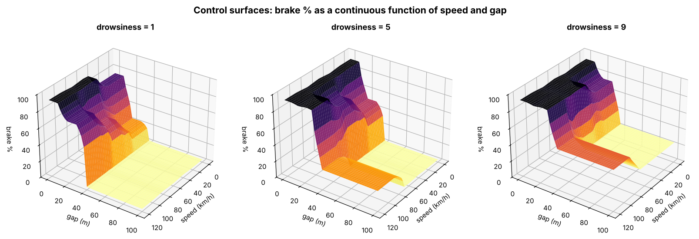
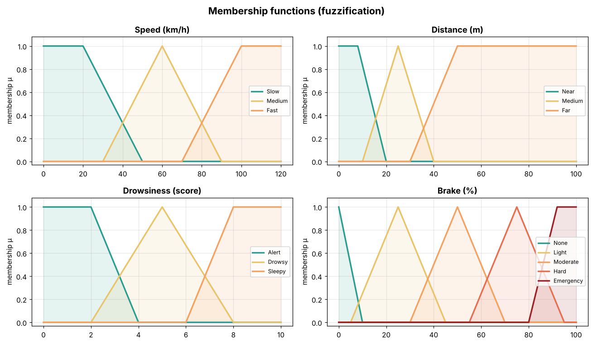
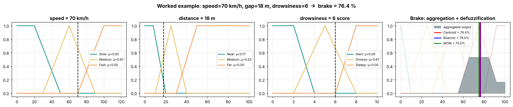
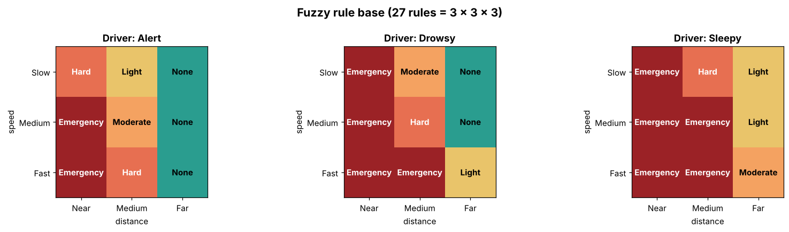
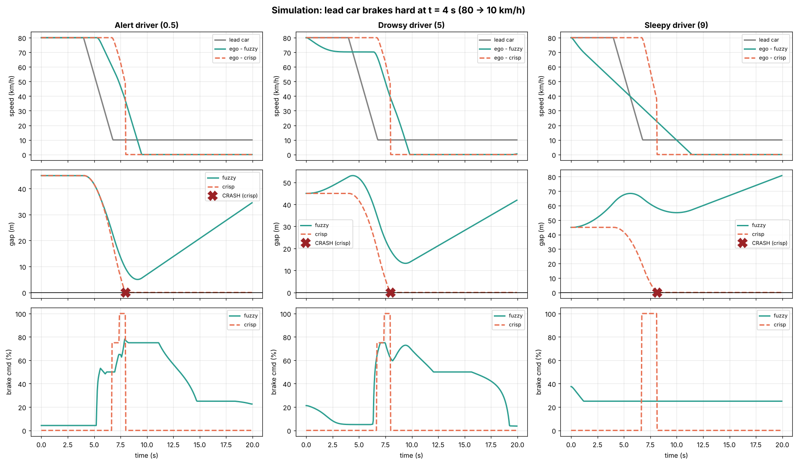
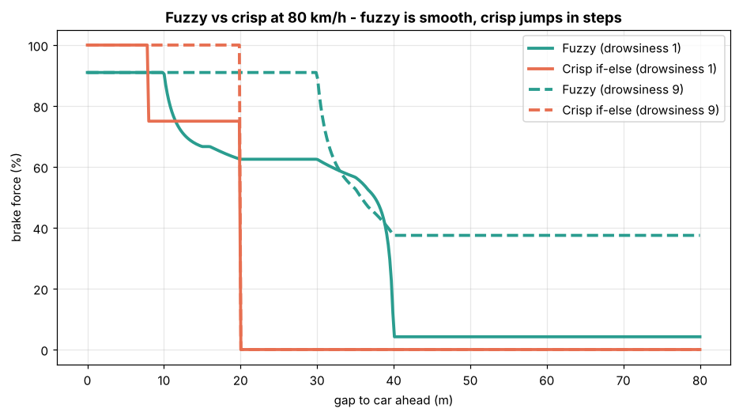
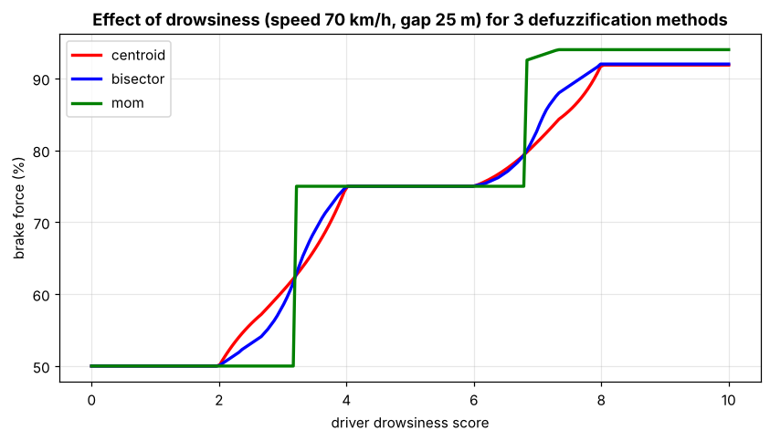

<div align="center">

# 🚗 Fuzzy Driver-Drowsiness & Braking Assist

**A Mamdani fuzzy inference engine — written from scratch in pure NumPy — that decides how hard a car should brake based on speed, gap, and driver drowsiness.**

[](https://python.org)
[](https://numpy.org)
[](https://streamlit.io)
[](LICENSE)
[]()

<br>



<sub>Control surfaces: brake % as a smooth, continuous function of speed and gap — no hard thresholds, no jerky transitions.</sub>

</div>

---

## 🧠 The Problem

A drowsy driver reacts **1–2 seconds late**. At 80 km/h, that's **22–44 meters** of uncontrolled travel. Traditional `if-else` controllers use hard thresholds — a 0.1 m change in gap can flip the brake from 0% to 75%, causing **jerky, dangerous braking** that arrives too late.

**Fuzzy logic solves this** by reasoning with gradual degrees of membership ("*a bit close*", "*quite fast*", "*somewhat drowsy*") instead of crisp yes/no decisions, producing **smooth, human-like braking** that acts earlier and more comfortably.

## ✨ Key Highlights

| | |
|:---|:---|
| 🔧 **From-scratch engine** | Complete Mamdani FIS using only NumPy — no `skfuzzy` or any fuzzy library |
| 🧩 **27 fuzzy rules** | Complete 3×3×3 rule base covering every input combination |
| 🎯 **3 defuzzification methods** | Centroid (COG), Bisector, and Mean of Maximum — all implemented and compared |
| 📊 **Full simulation** | Car-following physics with actuator lag, dead zones, and cruise control |
| 🚨 **Drowsiness-aware** | The assist brakes *earlier and harder* for drowsy drivers, and safely stops a sleeping driver |
| 🖥️ **Interactive demo** | Streamlit app with real-time sliders and live visualization |

## 📋 System Design

### Inputs & Output

```
┌─────────────────────────────────────────────────────────────┐
│                  FUZZY BRAKING ASSIST                        │
│                                                             │
│   INPUTS                          OUTPUT                    │
│   ┌──────────────────┐            ┌───────────────────┐     │
│   │ Speed   0-120 km/h│           │ Brake   0-100 %   │     │
│   │ → Slow/Med/Fast  │──┐        │ → None / Light /  │     │
│   └──────────────────┘  │  ┌───┐ │   Moderate / Hard /│     │
│   ┌──────────────────┐  ├─→│FIS├→│   Emergency       │     │
│   │ Gap     0-100 m  │  │  └───┘ └───────────────────┘     │
│   │ → Near/Med/Far   │──┤          Mamdani Inference        │
│   └──────────────────┘  │          with Centroid Defuzz      │
│   ┌──────────────────┐  │                                   │
│   │ Drowsiness 0-10  │──┘                                   │
│   │ → Alert/Drowsy/  │                                      │
│   │   Sleepy          │                                      │
│   └──────────────────┘                                      │
└─────────────────────────────────────────────────────────────┘
```

### Membership Functions

<div align="center">

</div>

> Triangular MFs for middle terms, trapezoidal for shoulders/extremes. Hand-tuned for realistic driving behavior — a Gaussian MF is also implemented but not used since it never reaches exactly zero.

## 🔬 How It Works — Mamdani Inference Pipeline

```
  Crisp Inputs                                                    Crisp Output
  ┌────────┐     ┌──────────────┐    ┌────────────┐    ┌───────────────┐    ┌────────────────┐
  │speed=70│────→│ FUZZIFICATION│───→│   27 RULES  │───→│  AGGREGATION  │───→│DEFUZZIFICATION │───→ brake = 76.4%
  │gap=18  │     │ crisp → μ    │    │ AND = min   │    │  max (union)  │    │  centroid COG  │
  │drowsy=6│     │              │    │ clip at α   │    │               │    │                │
  └────────┘     └──────────────┘    └────────────┘    └───────────────┘    └────────────────┘
                       ①                  ②③                  ④                    ⑤
```

### Step-by-Step Worked Example

<div align="center">

</div>

**Input:** speed = 70 km/h, gap = 18 m, drowsiness = 6

| Step | What Happens | Values |
|:-----|:-------------|:-------|
| **① Fuzzification** | Crisp → membership degrees | Speed: Medium=0.67 · Gap: Near=0.17, Medium=0.53 · Drowsy=0.67 |
| **② Rule evaluation** | AND = min of antecedents | Rule 1: min(0.67, 0.17, 0.67) = **0.17** → Emergency |
| | | Rule 2: min(0.67, 0.53, 0.67) = **0.53** → Hard |
| **③ Implication** | Clip output sets at α (Mamdani) | Emergency clipped at 0.17, Hard clipped at 0.53 |
| **④ Aggregation** | Max of all clipped sets | Combined fuzzy output set, peak = 0.53 |
| **⑤ Defuzzification** | Centroid of aggregated set | **76.4%** (Bisector: 76.0%, MOM: 75.0%) |

> **Hand verification:** Medium speed = (90−70)/(90−60) = 0.67 ✓ · Near gap = (20−18)/(20−8) = 0.17 ✓ · Medium gap = (18−10)/(25−10) = 0.53 ✓

## 📏 Rule Base — 27 Rules (3 × 3 × 3)

<div align="center">

</div>

The rule base implements escalating safety logic:

- **Alert driver** → Standard safety: brake only when the gap is unsafe
- **Drowsy driver** → Escalates by one level (driver reacts ~1s late)
- **Sleepy driver** → Maximum escalation + gentle braking even at far gaps (a sleeping driver shouldn't keep cruising)

## 📊 Results — Fuzzy vs Crisp Controller

### Simulation: Lead car brakes 80 → 10 km/h at t = 4s

<div align="center">

</div>

| Scenario | Controller | Collision | Min Gap | Peak Decel | RMS Jerk | Smoothness |
|:---------|:-----------|:---------:|--------:|-----------:|---------:|:-----------|
| Alert driver | **Fuzzy** | ✅ Safe | 5.01 m | 6.71 m/s² | 1.73 m/s³ | Smooth |
| Alert driver | Crisp | 💥 **CRASH** | 0.00 m | 8.98 m/s² | 4.82 m/s³ | Jerky |
| Drowsy driver | **Fuzzy** | ✅ Safe | 13.24 m | 6.62 m/s² | 2.21 m/s³ | Smooth |
| Drowsy driver | Crisp | 💥 **CRASH** | 0.00 m | 8.98 m/s² | 4.82 m/s³ | Jerky |
| Sleepy driver | **Fuzzy** | ✅ Safe | 45.00 m | 2.75 m/s² | 1.04 m/s³ | Very smooth |
| Sleepy driver | Crisp | 💥 **CRASH** | 0.00 m | 9.00 m/s² | 6.12 m/s³ | Very jerky |

> **Key takeaway:** The fuzzy controller avoids collision in **all** scenarios with **2–6× smoother** braking. The crisp controller waits until a hard threshold is crossed and then slams the brakes — too late.

### Why Fuzzy Wins

<div align="center">

</div>

<sub>Fuzzy produces a smooth, continuous curve. Crisp jumps in steps — each step is a jerk to the passengers and a skid risk.</sub>

### Effect of Drowsiness & Defuzzification Method Comparison

<div align="center">

</div>

## 🚀 Quick Start

### Prerequisites

- Python 3.9+
- pip

### Installation & Run

```bash
# Clone the repository
git clone https://github.com/yourusername/fuzzy-brake-assist.git
cd fuzzy-brake-assist

# Install dependencies
pip install -r requirements.txt

# Run the full demo (worked example + simulation + generates all figures)
python main.py

# Try your own inputs: speed(km/h) gap(m) drowsiness(0-10)
python main.py 90 20 7

# Run unit tests
python test_fuzzy.py

# Launch the interactive Streamlit app
streamlit run app.py
```

### Sample Output

```
======================================================================
 FUZZY BRAKING ASSIST  |  speed=70 km/h   gap=18 m   drowsiness=6
======================================================================

STEP 1 - FUZZIFICATION (crisp -> membership degrees)
  speed      : Slow=0.00   Medium=0.67   Fast=0.00
  distance   : Near=0.17   Medium=0.53   Far=0.00
  drowsiness : Alert=0.00   Drowsy=0.67   Sleepy=0.00

STEP 2 - RULE EVALUATION (AND = min)  - only rules that fire:
  α=0.17  IF speed is Medium AND distance is Near AND drowsiness is Drowsy THEN brake is Emergency
  α=0.53  IF speed is Medium AND distance is Medium AND drowsiness is Drowsy THEN brake is Hard

STEP 3 - IMPLICATION (clip each output set at α, Mamdani min)
STEP 4 - AGGREGATION (max of all clipped sets)
  aggregated set peak height = 0.53

STEP 5 - DEFUZZIFICATION
  Centroid (COG)   :  76.44 %   <- used by the system
  Bisector         :  76.00 %
  Mean of Maximum  :  75.00 %

  >>> FUZZY BRAKE = 76.4 %     (crisp if-else would give 75 %)
======================================================================
```

## 📁 Project Structure

```
fuzzy-brake-assist/
├── fuzzy_engine.py        # 🧠 From-scratch Mamdani FIS engine
│                          #    trimf, trapmf, gaussmf, FuzzyVariable,
│                          #    Rule, MamdaniSystem, 3 defuzzifiers
├── braking_system.py      # 🚗 Application layer: variables, 27 rules,
│                          #    membership functions, crisp baseline
├── simulation.py          # 📈 Car-following physics simulation
│                          #    (actuator lag, dead zone, cruise control)
├── plots.py               # 📊 All 7 publication-quality figures
├── main.py                # ▶️  Demo entry point with step-by-step output
├── app.py                 # 🖥️  Interactive Streamlit dashboard
├── test_fuzzy.py          # ✅ 6 unit tests (MFs, operators, completeness)
├── requirements.txt       # 📦 Dependencies (numpy, matplotlib, streamlit)
├── outputs/               # 🖼️  Generated figures and metrics
│   ├── 1_membership_functions.png
│   ├── 2_worked_example.png
│   ├── 3_control_surfaces.png
│   ├── 4_fuzzy_vs_crisp_curve.png
│   ├── 5_rule_base.png
│   ├── 6_simulation.png
│   ├── 7_drowsiness_and_defuzz.png
│   ├── demo_output.txt
│   └── metrics.txt
└── VIVA.md                # 🎤 34 Q&A for viva preparation
```

## 🛠️ Technical Details

### Engine Components (`fuzzy_engine.py`)

| Component | Implementation |
|:----------|:---------------|
| **Membership Functions** | `trimf` (triangular), `trapmf` (trapezoidal), `gaussmf` (Gaussian) |
| **Set Operations** | Zadeh operators — `fuzzy_and` (min), `fuzzy_or` (max), `fuzzy_not` (1−μ) |
| **Linguistic Variable** | `FuzzyVariable` class with terms, fuzzification, and curve generation |
| **Rules** | `Rule` class supporting AND/OR antecedents with NOT and weights |
| **Inference** | `MamdaniSystem` — full pipeline: fuzzify → evaluate → clip → aggregate → defuzzify |
| **Defuzzification** | Centroid ($z^* = \Sigma \mu(z) \cdot z \;/\; \Sigma \mu(z)$), Bisector, Mean of Maximum |

### Simulation Physics (`simulation.py`)

- **Max deceleration:** 9.0 m/s² (~0.9g, dry road) at 100% brake
- **Actuator lag:** First-order, τ = 0.15s
- **Dead zone:** Brake commands < 5% are ignored (pedal free play)
- **Cruise control:** Smooth re-acceleration ≤ 1.5 m/s²
- **Time step:** 50 ms (Δt = 0.05s)

## 🔮 Limitations & Future Work

- [ ] Add **relative/closing speed** — time-to-collision would let the car release the brake once the gap is opening
- [ ] **Optimize membership functions** with a Genetic Algorithm or learn them with ANFIS (neuro-fuzzy)
- [ ] Real drowsiness input via webcam: eye-aspect-ratio / PERCLOS detection (OpenCV + MediaPipe)
- [ ] Add **road condition** (wet/dry/icy) as a 4th input to scale maximum deceleration
- [ ] Integrate with a driving simulator (CARLA / SUMO) for more realistic evaluation

## 📚 References

1. L. A. Zadeh, "Fuzzy Sets", *Information and Control*, 1965.
2. E. H. Mamdani & S. Assilian, "An experiment in linguistic synthesis with a fuzzy logic controller", *Int. J. Man-Machine Studies*, 1975.
3. S. Russell & P. Norvig, *Artificial Intelligence: A Modern Approach*, 4th Ed.
4. T. J. Ross, *Fuzzy Logic with Engineering Applications*, Wiley.

## 📄 License

This project is licensed under the [MIT License](LICENSE).

---

<div align="center">

**Built with ❤️ for CSE3121 — Artificial Intelligence & Soft Computing**

*Manipal University Jaipur*

</div>
